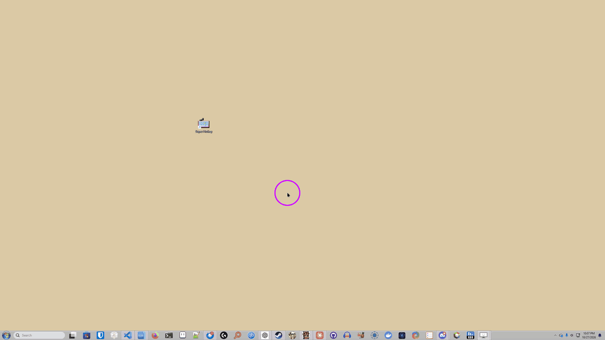

# Super Hotkey

A small AutoHotkey v2 suite for window management, quick notes and everyday keyboard shortcuts I found useful.

Built by a non-programmer: ChatGPT wrote the early versions and Claude Code the later ones; I design, direct and test it.

*This recording shows v1.0.0-beta.1; some keys and behavior have changed since. I'll record a new one once things settle.*

## Modules

Use any module on its own or combine them.

| Module | Purpose |
| --- | --- |
| [Wonder Windows](#wonder-windows) | Position, stretch, stack and cycle windows |
| [Cascade Kingdom](#cascade-kingdom) | Keep many windows in an overlapping cascade |
| [Paper Pad](#paper-pad) | A quick-notes drawer using Notepad3 |
| [Power-Up Utilities](#power-up-utilities) | Extra keys, text shortcuts and system utilities |
| [Secret Layers](#secret-layers) | Use CapsLock and Pause as extra keyboard layers |

### Wonder Windows

There are plenty of window managers for Windows, but the ones I tried tiled windows smaller than I liked, took a while to learn, or spread things across so many workspaces that I lost track of them. Small costs, but they added up. This is my take on window management that builds on the `Win` key shortcuts you already know and makes the ones I found frustrating or incomplete more predictable.

Hold `Win` and scroll, or press `Win + Left/Right`, to walk the active window through zones: full-height fourths and halves first, then the same zones in the upper and lower half of the display. The other direction steps back, and releasing `Win` starts over next time. Settings offers thirds instead.

Windows can also sit side by side with others stacked behind them: `Win + Enter` cycles through the stack, and `Alt + Win + arrow` moves a window onto its nearest neighbor to stack them. `Win + Shift + Enter` stretches a window across to its neighbors, then into all the free space around it, then back.

### Cascade Kingdom

Keep windows in an overlapping cascade, which helps most when many apps are open. Every window keeps 80% of the display's width and height, however many you add.

Each slot in the cascade gets a small colored focus tab, so every slot stays one click away: click a tab to bring its window forward, and click it again to cycle through the windows sharing that slot. From the keyboard, `Caps + PgUp/PgDn` steps through them. `Caps + M` hides the cascade on your display and `Caps + Shift + M` brings it back together.

With two displays, for example, keep focused work in narrow zones on one, wide apps like file managers, video players or Discord on the other, and secondary apps in a cascade on whichever display you choose in Settings.

### Paper Pad

A quick-notes drawer: `Win + F12` shows or hides a dedicated Notepad3 window that stays on top while it's open, so you can jot something down without hunting through other windows and tabs.

`Ctrl + N` creates a timestamped page, and `Win + Left/Right` move between pages inside the drawer. Changes are saved automatically when you switch pages, hide the drawer or exit, and pages stay ordinary files in your notes folder.

### Power-Up Utilities

Send F13-F24 or use a virtual number pad, even if your keyboard doesn't have those keys. Insert punctuation, special characters or a timestamp without looking them up.

In Windows Terminal, copy the buffer as Markdown or clear it; both use Terminal's default `Ctrl + Shift + A`, `C` and `K` shortcuts. Other shortcuts wake speakers that have gone into standby or put the computer to sleep.

### Secret Layers

Hold CapsLock or Pause and press another key for extra hotkeys, or tap it first so you don't have to hold both. `Caps` and `Pause` hotkeys use these layers. Double-tap Shift to toggle Caps Lock.

## Start

Install [AutoHotkey v2](https://www.autohotkey.com/) **64-bit**, extract the project and run `super-hotkey.ahk`.

Try these first:

- Hold `Win` and scroll to walk the active window through zones.
- Press `Win + F12` to open the Paper Pad notes drawer. It needs [Notepad3](https://www.rizonesoft.com/downloads/notepad3/) and asks you to install or locate it when it can't find it.
- Press `Ctrl + Alt + K` to see and change every hotkey.

Right-click the tray icon for guides, settings and **Modules...**, where you can turn off what you don't need.

Settings and logs live in `%LOCALAPPDATA%\nroj\SuperHotkey`.

## Compatibility

Other window managers and tiling tools can conflict with Super Hotkey when they also move windows, rearrange them after display changes, or use the same hotkeys.

PowerToys FancyZones does all three, so it isn't supported; disable it in PowerToys. For `Shift + drag` window placement, I recommend [ScreenGrid](https://github.com/TtesseractT/ScreenGrid) instead. It shows a grid overlay for dropping windows into zones and works well alongside Super Hotkey.

## Develop

Edit `core/` and `modules/` directly; [AGENTS.md](AGENTS.md) explains the architecture. Run `python tests/check.py` before committing.

Super Hotkey is free, and I'll never charge for it. The official source is [github.com/nroj95/super-hotkey](https://github.com/nroj95/super-hotkey); a paid version anywhere else doesn't come from me.

Code: [MIT](LICENSE). Icon: [FatCow attribution](assets/ATTRIBUTION.md).
