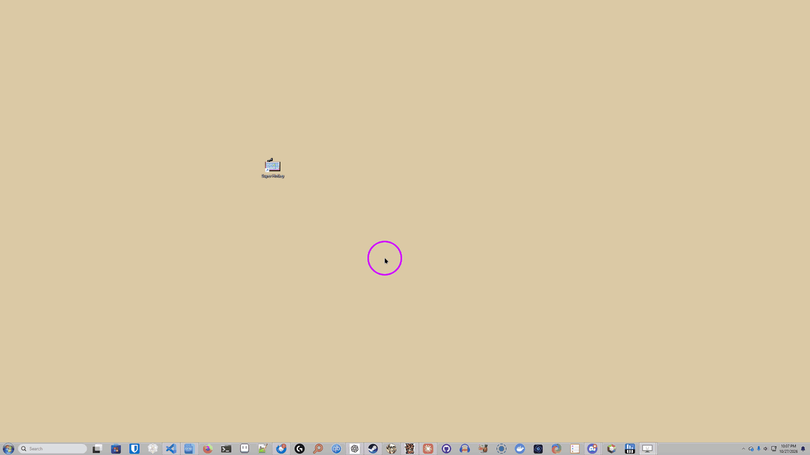

# Super Hotkey

A small AutoHotkey v2 suite for window management, quick notes and everyday keyboard shortcuts I found useful.

Built by a non-programmer: ChatGPT wrote the early versions and Claude Code the later ones; I design, direct and test it.

*This recording shows v1.0.0-beta.1; some keys and behavior have changed since. I'll record a new one once things settle.*

## Modules

Use any module on its own or combine them.

| Module | Purpose |
| --- | --- |
| [Wonder Windows](#wonder-windows) | Position, stretch, stack and cycle windows |
| [Cascade Kingdom](#cascade-kingdom) | Keep many windows in an overlapping cascade |
| [Paper Pad](#paper-pad) | A quick-notes drawer using Notepad3 |
| [Power-Up Utilities](#power-up-utilities) | Extra keys, text shortcuts and system utilities |
| [Secret Layers](#secret-layers) | Use CapsLock and Pause as extra keyboard layers |

### Wonder Windows

There are plenty of window managers for Windows, but the ones I tried tiled windows smaller than I liked, took a while to learn, or spread things across so many workspaces that I lost track of them. Small costs, but they added up. This is my take on window management that builds on the `Win` key shortcuts you already know and makes the ones I found frustrating or incomplete more predictable.

`Win + Left/Right` put the active window in that half of the display, as Windows does, and start *zone mode*, which lasts while you hold `Win`. In zone mode a window sits only where both its edges land on halves, fourths or thirds, so a half can sit left, in the middle or right, and windows always fit together. `Left/Right` slide it to its next place, or on to the next display, as Windows does, `Down` and `Up` make it the bottom or top quarter and then slide it, and `Shift` with an arrow makes it one size bigger or smaller and snaps it into place (Settings can add sixths, or leave out fourths or thirds, separately along the display's long and short side). For zones you drag with the mouse, I strongly recommend [ScreenGrid](https://github.com/TtesseractT/ScreenGrid): hold `Shift` while you drag a window and drop it on a grid. It works alongside Super Hotkey, and zone mode is a keyboard extra for when you feel like it.

Windows can also sit side by side with others stacked behind them: `Win + Shift + PgDn` cycles through the stack, `Win + Shift + PgUp` the other way, and `Alt + Win + arrow` moves a window onto its nearest neighbor to stack them.

For big windows, `Win + Alt + Enter` shows the next maximized or fullscreen window on your display and minimizes the others, so one is out at a time. Add `Shift` to go back.

Windows' own keys work as you know them, with fewer surprises, and each has one job. `Win + Up` maximizes, then steps to the upper and lower half, and `Win + Down` takes a window back to normal size but never minimizes; `Win + Backspace` does that. `Win + Shift + Up` and `Win + Shift + Down` stretch a window to the full height or width of the display and back, and `Win + Enter` stretches it into the free space around it and back, maximizing it when nothing is beside it. `Win + M`, `Win + Home` and `Win + D` take `Shift` to bring back what they minimized, however much you do in between, and act on your display only, except `Win + D`, which reaches every display.

### Cascade Kingdom

Keep windows in an overlapping cascade, which helps most when many apps are open. Every window keeps 80% of the display's width and height, however many you add. It steps down to the right, or to the left with Mirror in Settings.

Add the active window with `Caps + Insert`, or hold `Caps` and double-click any window; double-click it again, or press `Caps + Shift + Insert`, to take it out and put it back where it was. While `Caps` is held, clicks only focus windows, so you can bring a window forward from anywhere on it without clicking what is inside. Settings can use `Pause` or `Win` for this instead, or turn it off. Drag a window in the cascade onto another slot to move it there, or anywhere else to take it out at its old size. While you drag, the slot it will take lights up in your accent color.

Each slot in the cascade gets a small colored focus tab on both sides, at the lower left and the upper right, so every slot stays one click away from either side: click a tab to bring its window forward, and click it again to cycle through the windows sharing that slot. From the keyboard, `Caps + PgUp/PgDn` steps through them, and `Caps + Tab` jumps to the next cascade, on whichever display it is. When another window covers part of your cascade, `Caps + Tab` first brings it back to the front. `Caps + M` hides the cascade on your display and `Caps + Shift + M` brings it back together.

With two displays, for example, keep focused work in narrow zones on one, wide apps like file managers, video players or Discord on the other, and secondary apps in a cascade on whichever display you choose in Settings.

### Paper Pad

A quick-notes drawer: `Win + F12` or `Caps + F12` shows or hides a dedicated Notepad3 window that stays on top while it's open, so you can jot something down without hunting through other windows and tabs.

`Ctrl + N` creates a timestamped page, and `Win + Left/Right` move between pages inside the drawer. Changes are saved automatically when you switch pages, hide the drawer or exit, and pages stay ordinary files in your notes folder.

### Power-Up Utilities

Send F13-F24 or use a virtual number pad, even if your keyboard doesn't have those keys. Insert punctuation, special characters or a timestamp without looking them up.

In Windows Terminal, copy the buffer as Markdown or clear it; both use Terminal's default `Ctrl + Shift + A`, `C` and `K` shortcuts. Other shortcuts put the computer to sleep, and `Pause + Pause` turns the displays off until you touch the mouse or keyboard; waking speakers that have gone into standby is an action you can give a hotkey in Keybindings. `Pause + End` keeps it awake for 30 minutes and then puts it to sleep, with a warning a minute and 30 seconds before, and back after half an hour away it tells you how long is left; press again while the notice shows for 1, 2, 4 or 8 hours or no limit, and `Pause + Shift + End` stops it without sleeping.

### Secret Layers

Hold CapsLock or Pause and press another key for extra hotkeys, or tap it first so you don't have to hold both. `Caps` and `Pause` hotkeys use these layers. Double-tap Shift to toggle Caps Lock.

## Start

1. Install [AutoHotkey v2](https://www.autohotkey.com/) **64-bit**.
2. Download the newest [release](https://github.com/nroj95/super-hotkey/releases), extract it and run `super-hotkey.ahk`.
3. Right-click the tray icon and check **Run at startup** to have it ready after every sign-in.

Try these first:

- Press `Win + Left` or `Win + Right`, keep holding `Win`, and use the arrows, with or without `Shift`, to size the window.
- Press `Win + M`, then `Win + Shift + M`: only your display clears, and everything comes back in order.
- Press `Win + F12` to open the Paper Pad notes drawer. It needs [Notepad3](https://www.rizonesoft.com/downloads/notepad3/) and asks you to install or locate it when it can't find it.
- Press `Ctrl + Alt + K` to see and change your hotkeys.

The tray icon also has guides, settings and **Modules...**, where you can turn off what you don't need, and **Language...**. Settings and logs live in `%LOCALAPPDATA%\nroj\SuperHotkey`.

## Compatibility

Other window managers and tiling tools can conflict with Super Hotkey when they also move windows, rearrange them after display changes, or use the same hotkeys.

PowerToys FancyZones does all three, so it isn't supported; disable it in PowerToys and use [ScreenGrid](https://github.com/TtesseractT/ScreenGrid) for zones you drag with the mouse.

## Develop

Edit `core/` and `modules/` directly; [AGENTS.md](AGENTS.md) explains the architecture. Run `python tests/check.py` before committing.

To translate Super Hotkey into your language, see [lang/README.md](lang/README.md).

Super Hotkey is free, and I'll never charge for it. The official source is [github.com/nroj95/super-hotkey](https://github.com/nroj95/super-hotkey); a paid version anywhere else doesn't come from me.

Code: [MIT](LICENSE). Icon: [FatCow attribution](assets/ATTRIBUTION.md).
